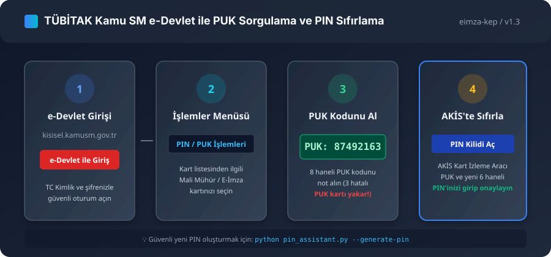
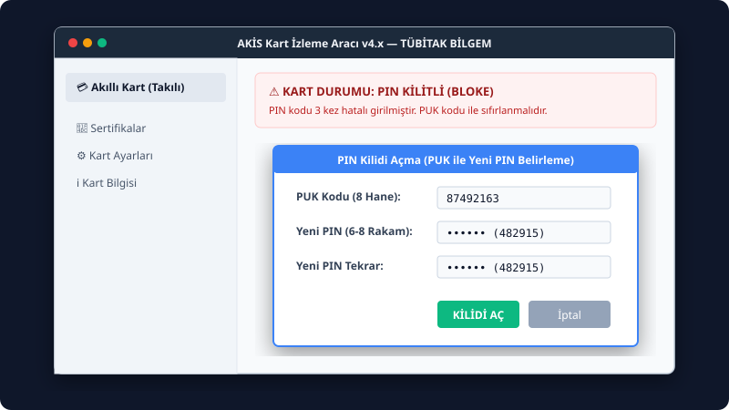
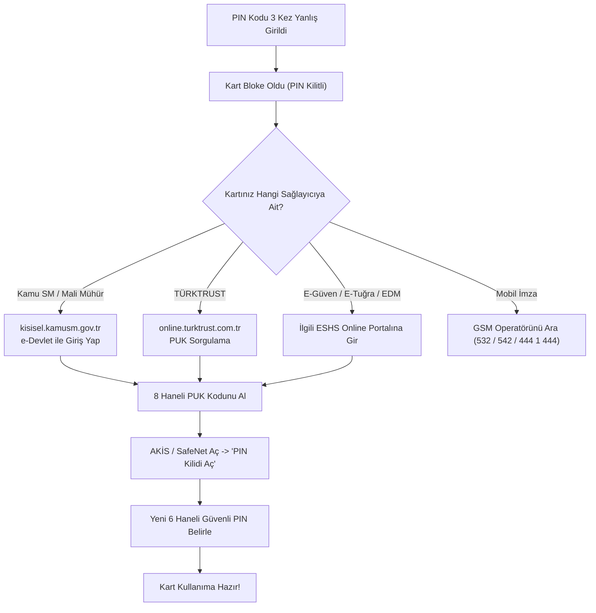

# E-İmza PIN Bloke Kaldırma ve PUK Asistanı 🔓🔑

[](https://github.com/eimza-kep/eimza-pin-bloke-asistani/actions)
[](LICENSE)
[](https://github.com)
[](docs/kamusm_puk_rehberi.svg)
[](https://eimzabilgi.site/)

Türkiye'deki yetkili Elektronik Sertifika Hizmet Sağlayıcıları (TÜBİTAK Kamu SM / Mali Mühür, TÜRKTRUST, E-Güven, E-Tuğra, EDM Bilişim, E-İmzaTR) ve GSM operatörlerinin (Turkcell, Vodafone, Türk Telekom Mobil İmza) **e-imza USB token PIN bloke kaldırma adımlarını, e-Devlet kapısı üzerinden PUK sorgulama rehberini, interaktif terminal sihirbazını** ve ISO 7816-4 APDU komut dizilerini sunan açık kaynaklı asistan.

---

## 📸 Görsel PUK Kurtarma ve AKİS PIN Sıfırlama Rehberi

### 1. TÜBİTAK Kamu SM e-Devlet ile PUK Alma Akışı
Aşağıdaki infografik, `kisisel.kamusm.gov.tr` portalı üzerinden e-Devlet ile giriş yapılarak PUK kodunun alınması ve AKİS ile kilidin çözülmesi adımlarını göstermektedir:



### 2. AKİS Kart İzleme Aracı "PIN Kilidi Aç" Ekranı
Kartınız bloke olduğunda AKİS arayüzünde "PIN Kilidi Aç" butonu ile PUK kodunu ve belirleyeceğiniz yeni 6 basamaklı PIN'i girmeniz yeterlidir:



---

## 🔄 Karar Ağacı: PIN Bloke Olduğunda Ne Yapılmalı?



---

## ✨ Öne Çıkan Özellikler (v1.3)

* 🧙 **İnteraktif Terminal Sihirbazı:** `--wizard` ile sağlayıcı seçimi, PUK doğrulama ve yeni PIN oluşturmayı adım adım yönlendirir.
* 🏛️ **e-Devlet Entegrasyonlu Kamu SM Rehberi:** Adım adım infografikler ve doğrudan portal yönlendirmeleri.
* 🛡️ **Güvenli PIN Doğrulama:** Ardışık (123456), tekrarlayan (111111) ve zayıf PIN kombinasyonlarını engelleyen denetim motoru.
* 🎲 **Kriptografik PIN Üretici:** `--generate-pin` ile kurallara tam uyumlu rastgele 6 basamaklı yeni PIN üretimi.
* 🔍 **PUK Biçim Doğrulayıcı:** `--validate-puk` ile 8 haneli PUK formatı denetimi.
* ⚡ **AKİS & CardOS APDU Üreteci:** ISO 7816-4 RESET RETRY COUNTER (`0x2C`) komut dizisi ile terminalden doğrudan PUK açma.
* 📑 **Çevrimdışı Görsel HTML Rapor:** `--html-guide` ile tarayıcıda görüntülenebilir bağımsız doküman üretir.

---

## 🛠️ Kurulum ve Yerel Geliştirme (Local Setup)

### Sistem Gereksinimleri
- Python 3.8 veya üzeri
- `git`
- (İsteğe bağlı) Windows PowerShell veya Bash

### 1. Depoyu Klonlama ve Çalışma Ortamı
```bash
# Depoyu klonlayın
git clone https://github.com/eimza-kep/eimza-pin-bloke-asistani.git
cd eimza-pin-bloke-asistani

# Sanal ortam (virtualenv) oluşturma ve aktifleştirme (Opsiyonel)
python -m venv venv
# Linux/macOS:
source venv/bin/activate
# Windows PowerShell:
.\venv\Scripts\Activate.ps1
```

### 2. Birim Testleri Çalıştırma
```bash
python test_pin_assistant.py
```
veya `unittest` keşif mekanizmasıyla:
```bash
python -m unittest discover -v
```

---

## 🚀 Hızlı Başlangıç ve Kullanım Kılavuzu

### 1. Adım Adım İnteraktif Asistanı Başlatma
```bash
python pin_assistant.py --wizard
```

### 2. Sağlayıcı PUK Rehberini Görüntüleme
```bash
# Sadece Kamu SM (Mali Mühür) adımlarını listeleme
python pin_assistant.py --provider kamusm

# Tüm sağlayıcıları JSON olarak alma
python pin_assistant.py --provider all --json
```

### 3. Otomatik Güvenli Rastgele PIN Üretme
```bash
python pin_assistant.py --generate-pin
```

### 4. PIN ve PUK Kodu Doğrulama
```bash
# Yeni belirlenen PIN kodunun güvenlik kurallarına uygunluğunu test etme
python pin_assistant.py --validate-pin 482915

# Girilen PUK kodunun formatını denetleme
python pin_assistant.py --validate-puk 87492163
```

### 5. AKİS & CardOS İçin APDU PUK Sıfırlama Komutu Üretme
```bash
# TÜBİTAK AKİS akıllı kartlar için APDU komutu
python pin_assistant.py --generate-apdu --card-type akis --puk 87492163 --new-pin 482915

# Siemens/Atos CardOS kartlar için APDU komutu
python pin_assistant.py --generate-apdu --card-type cardos --puk 87492163 --new-pin 482915
```

### 6. Çevrimdışı HTML Görsel Rehber Dosyası Üretme
```bash
python pin_assistant.py --html-guide pin_kurtarma_rehberi.html
```

---

## 🏢 Yetkili ESHS ve PUK Temin Portalları

| Sağlayıcı | Kapsam | Online PUK Portalı | Giriş Yöntemi |
|:---|:---|:---|:---|
| **TÜBİTAK Kamu SM** | Mali Mühür, Kamu E-İmza | [kisisel.kamusm.gov.tr](https://kisisel.kamusm.gov.tr/) | **e-Devlet ile Giriş** / SMS |
| **TÜRKTRUST** | Bireysel ve Kurumsal E-İmza | [online.turktrust.com.tr](https://online.turktrust.com.tr/) | TC Kimlik No / SMS Şifre |
| **E-Güven** | Bireysel ve Kurumsal E-İmza | [e-imza.e-guven.com](https://e-imza.e-guven.com/) | SMS Doğrulama / Müşteri No |
| **E-Tuğra** | EBG Bilişim E-İmza | [www.e-tugra.com.tr](https://www.e-tugra.com.tr/) | Kullanıcı Portalı / SMS |
| **EDM Bilişim** | EDM E-İmza & KEP | [portal.edmbilisim.com.tr](https://portal.edmbilisim.com.tr/) | Müşteri Portalı |
| **E-İmzaTR** | Bireysel ve Kurumsal E-İmza | [www.e-imzatr.com.tr](https://www.e-imzatr.com.tr/) | Online İşlemler |
| **Turkcell Mobil İmza** | SIM Tabanlı Mobil İmza | Turkcell Müşteri Hizmetleri (532) | Kimlik Doğrulaması |
| **Vodafone Mobil İmza** | SIM Tabanlı Mobil İmza | Vodafone Müşteri Hizmetleri (542) | Güvenlik Teyidi |
| **Türk Telekom Mobil İmza** | SIM Tabanlı Mobil İmza | Türk Telekom Müşteri Hizmetleri (444 1 444) | Müşteri Hizmetleri / Ofis |

> ⚠️ **HAYATİ UYARI:** PIN kodu 3 kez yanlış girildiğinde kart bloke olur ve PUK gerektirir. **PUK kodu da 3 kez yanlış girilirse kart kalıcı olarak kilitlenir (yanar)** ve yeni kart başvurusu yapılması zorunlu hale gelir. PUK kodunu girerken azami özen gösteriniz!

---

## 🔗 E-Dönüşüm Açık Kaynak Ekosistemi

Bu araç [eimza-kep](https://github.com/eimza-kep) organizasyonunun açık kaynak e-dönüşüm araçları ekosisteminin bir parçasıdır:

* 🇹🇷 **[awesome-turkiye-e-donusum](https://github.com/eimza-kep/awesome-turkiye-e-donusum):** Türkiye E-Dönüşüm kütüphane, mevzuat ve araçlar listesi.
* 🩺 **[akilli-kart-surucu-teshis](https://github.com/eimza-kep/akilli-kart-surucu-teshis):** Akıllı kart okuyucu ve sürücü teşhis aracı.
* ⏱️ **[mali-muhur-eimza-suresi-kontrol](https://github.com/eimza-kep/mali-muhur-eimza-suresi-kontrol):** Sertifika kalan gün denetimi ve bildirim scripti.
* 📄 **[python-pdf-eimza-dogrulayici](https://github.com/eimza-kep/python-pdf-eimza-dogrulayici):** PDF belgelerindeki PAdES e-imzaları doğrulama aracı.

---

## 📚 İlgili Teknik Rehberler
* 📄 [E-İmza PIN Kodu Bloke Oldu Ne Yapmalıyım? PUK ile Kilit Çözme](https://eimzabilgi.site/yazilar/eimza-pin-bloke-puk-kodu-sifirlama.html)
* 📄 [Mali Mühür Bloke Olduğunda PUK Kodu ile Kilit Nasıl Açılır?](https://malimuhur.site/yazilar/mali-muhur-pin-bloke-puk-kodu-cozum.html)
* 📄 [AKİS Akıllı Kart İzleme Aracında PIN Kilidi Açma Adımları](https://eimzabilgi.site/yazilar/akis-kart-izleme-araci-kullanim-rehberi.html)

---

## ⚖️ Lisans

Bu proje [MIT Lisansı](LICENSE) ile lisanslanmıştır.
